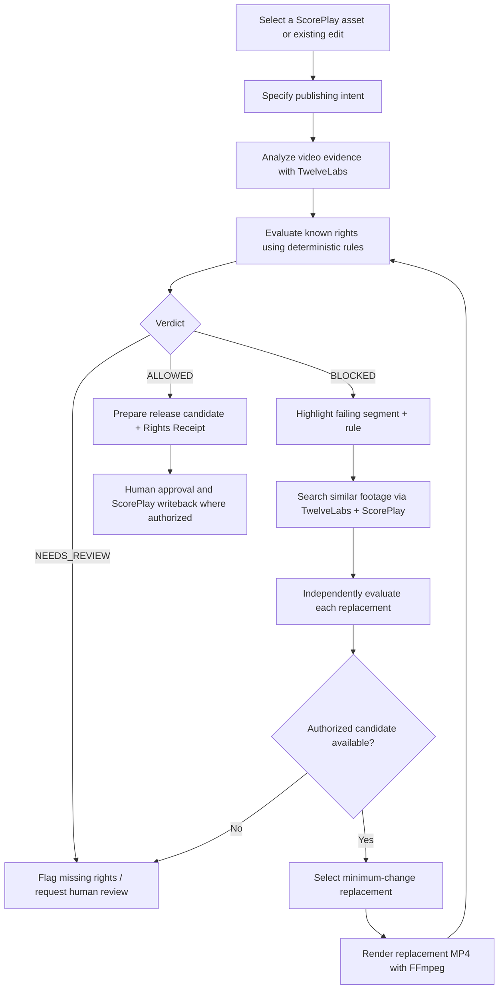

# spurs2-hackathon
2026 Spurs² Hackathon Repo

Go [here](https://docs.google.com/document/d/1252f8tKb08k262a8YEZ1vZVYKVKMjpQ52LskIH25cCE/edit?usp=sharing) for private Google Doc.


# REROUTE — Team Workflow

**Spurs² Hackathon · Rights & Compliance · October 22–23, 2026**  
**Tagline:** *Intent in. Publishable path out.*

## 1. What we're building

**REROUTE is a rights-aware creative resolution engine for sports media.**

Most rights tools answer: **“Can we publish this?”**  
REROUTE goes further: **“If we can't publish this version, what's the closest version we *can* prepare for approval?”**

Given a video edit and a publishing target, REROUTE:
1. Checks known rights restrictions against the target.
2. Pinpoints problematic segments and explains why.
3. Searches the media library for visually/semantically similar alternatives.
4. Independently checks the rights of each alternative.
5. Replaces the smallest possible part of the edit and renders a new MP4.
6. Produces an auditable **Rights Receipt** and writes results back to ScorePlay when permitted.

**Core principle: AI observes media; verified policies determine permissions; humans approve publication.**

## 2. The complete user workflow



### Step-by-step in the product

| Step | User sees | System does |
|---|---|---|
| **1. Choose an edit** | Sports video player + timeline | Loads assets, segments, metadata from ScorePlay |
| **2. Set publishing intent** | Territory, platform, usage, competition, publishing date | Defines the exact context for rights evaluation |
| **3. Check rights** | `ALLOWED`, `BLOCKED`, or `NEEDS_REVIEW` | Applies deterministic JSON policies to authoritative rights facts + video observations |
| **4. Inspect failure** | Red interval on timeline, rule ID, evidence/timecode | Shows which segment/rule/fact caused the result |
| **5. Click “Find a compliant path”** | Candidate alternatives with previews | Searches semantically similar segments with TwelveLabs; maps results back to ScorePlay |
| **6. REROUTE** | Original vs. proposed edit | Rejects unauthorized/unknown candidates, ranks eligible ones, replaces minimum footage, renders MP4 |
| **7. Review** | New video, passed constraints, missing facts, sources | Re-evaluates the *entire* generated edit; flags anything unresolved |
| **8. Save the decision** | Downloadable Rights Receipt | Records intent, policy versions, evidence, replacement provenance, final status; writes to ScorePlay if access allows |

## 3. Concrete demo — San Antonio Spurs

**Illustrative scenario:** Prepare a **15-second sponsored Instagram video** promoting a Spurs partner campaign in France on October 24.

The original edit contains:

```text
00:00–00:04  Player entrance            [eligible]
00:04–00:09  Dunk + an older brand mark [conflict under DEMO policy]
00:09–00:15  Celebration                [eligible]
```

A **fictional demo policy** says that a specific competing brand mark is not permitted in this particular sponsored campaign. This is **not a claim about any real Spurs, NBA, Ledger, or other sponsor agreement**.

**Live demo sequence:**

1. Open the 15-second edit in REROUTE.
2. Change the target from **Organic** to **Sponsored**. The status changes, and `00:04–00:09` is highlighted.
3. Open the evidence drawer: show the observed brand mark, source timecode, and matching **DEMO** rule.
4. Click **Find a compliant path**.
5. TwelveLabs finds similar dunk footage among available indexed clips; ScorePlay supplies the corresponding assets.
6. The rights engine checks every candidate against all required rights dimensions and selects an eligible alternative.
7. REROUTE replaces those 5 seconds using FFmpeg and displays **before / after**.
8. Re-check the new full edit, show the **Rights Receipt**, and submit for human approval / writeback.

**The WOW:** Not just “this video is blocked,” but **“here is a near-identical edit assembled from footage that independently satisfies the supplied rights policies.”**

### Secondary example — Tottenham / NFL at Tottenham Hotspur Stadium

A Tottenham venue-promotion video includes stadium footage and third-party NFL game footage. If the available rights records do not establish permission for the planned promotion, the NFL segment is `NEEDS_REVIEW`, **not** automatically allowed. REROUTE can search for separately cleared venue footage and propose an alternative cut. This demonstrates multiple rights holders, beyond sponsor detection.

## 4. Technology and responsibilities

| Component | Responsibility | Implementation |
|---|---|---|
| **ScorePlay** | Source of media, metadata, clips; optional receipt writeback | API adapter; verify actual key permissions first (`GET /whoami`) |
| **TwelveLabs** | Understand footage, identify timecoded evidence, find similar moments | Pegasus 1.6 for observations; Marengo 3.0 for semantic search |
| **Rights Engine** | Evaluate territories, platforms, competition, sponsor visibility, expiry, usage | Pure TypeScript + versioned JSON demo policies; deterministic and testable |
| **Resolution Planner** | Filter and rank replacement candidates | Hard rights filter first; then creative similarity + minimal edit distance |
| **Media Renderer** | Create the new video | FFmpeg trim + normalize + concatenate |
| **UI** | Make decisions and alternatives understandable | Next.js + Tailwind; player/timeline, Policy Dial, candidate comparison |
| **Rights Receipt** | Provide audit trail | Structured JSON: intent, evidence, policies, verdict, replacements, timestamps |

**Important distinction:** TwelveLabs can detect what appears in footage, but **cannot grant legal rights**. Only documented policies/entitlements and authorized human decisions can establish a permission.

## 5. Minimum decision rules

The engine must distinguish three outcomes:

- **ALLOWED:** Every mandatory rights dimension is affirmatively covered by applicable, valid permissions; no verified prohibition applies.
- **BLOCKED:** A verified, applicable prohibition/expiry prevents the requested use.
- **NEEDS_REVIEW:** Any required permission, fact, rule, or authoritative source is missing/ambiguous.

Hard invariant: **Missing evidence of a restriction is not evidence of permission.**  
A replacement **must be checked independently**. Editing out a logo does **not** automatically cure contractual restrictions. Every new composite edit must be re-evaluated.

Required dimensions for the hackathon brief: **territory · platform · competition · sponsor visibility · expiration**. Add commercial/organic usage in the demo as a useful extension.

## 6. Scope for the hackathon

### Must work (P0)

- One working 15-second video with 3 segments and explicit *fictional* rights policies.
- Policy Dial: target change leads to a real rights verdict change.
- Three-valued deterministic rights engine + rule/evidence trace.
- One real ScorePlay integration (as permitted by the API key).
- One real TwelveLabs query/analysis (cache its real result for demo reliability, clearly labeled).
- Alternative candidate evaluation; one eligible substitution.
- An **actual rendered MP4** using FFmpeg.
- Rights Receipt; ScorePlay writeback **if** the team's permissions support it.

### Nice to have (P1)

- Multiple candidate options and creative-similarity ranking.
- Second Tottenham example in the interface.
- Segment-by-segment observations dynamically extracted by Pegasus.

### Do not build tonight

Full contract ingestion, complex knowledge graphs, a swarm of agents, a full video editor, generalized legal reasoning, or multi-market batch rendering. These are future product directions.

## 7. Suggested split for a 4-person team

| Lane | Deliverable |
|---|---|
| **A — Rights / Product** | Policy schema, evaluation function, test cases, resolution rules, receipts |
| **B — Integrations** | ScorePlay access, media mapping, TwelveLabs evidence/search |
| **C — Frontend** | Player, segmented timeline, Policy Dial, failure details, alternative previews |
| **D — Rendering / End-to-end** | FFmpeg substitutions, complete workflow, writeback, robust demo |

If three people, combine **B + D**. Agree on shared TypeScript contracts for `PublishIntent`, `Asset`, `Segment`, `Decision`, `Alternative`, and `RightsReceipt` before parallel implementation.

## 8. Three-minute demo script

| Time | Action | Jury takeaway |
|---|---|---|
| **0:00–0:30** | Show the Spurs edit and set a sponsored publishing target | Rights depend on **how and where** content is used |
| **0:30–1:00** | Highlight the failing 5-second segment and open the evidence + demo rule | Every verdict is **explainable** |
| **1:00–2:10** | Click **REROUTE** → retrieve, rights-filter, substitute, preview actual MP4 | Compliance can trigger a **creative solution** |
| **2:10–2:45** | Show the re-evaluated candidate and Rights Receipt / writeback | Decisions are **auditable and actionable** |
| **2:45–3:00** | Close with the Tottenham multi-rights-holder use case | Same engine, **multiple clubs and sports** |

### The pitch

> **“Sports teams don't have a content shortage. They have a usable-content problem. REROUTE turns a publishing intent into the closest rights-compliant creative option. When part of an edit fails, we find a semantically similar replacement, validate its rights independently, rebuild the media, and provide an audit trail. AI finds the options; the rights rules remain authoritative; the human approves.”**

**Final line:** *“REROUTE turns compliance from a dead end into a creative path.”*

---

### Trust & demo disclosures

- **All sample contracts / campaign policies are fictional**, visibly labeled **DEMO POLICY — NOT AN ACTUAL TEAM OR LEAGUE AGREEMENT**.
- Actual Spurs/Tottenham/NBA/NFL/UEFA rights must **not** be inferred from who appears in the video, where it was filmed, or a detected logo.
- Clearly identify cached TwelveLabs results, locally stored ScorePlay assets, mock data, and unavailable writeback permissions.
- `ALLOWED` in a demo means **eligible under the supplied demo policies**, **not** a real-world legal clearance or permission to publish.

**Docs:** [ScorePlay API](https://developer.scoreplay.io/) · [TwelveLabs](https://docs.twelvelabs.io/home)
