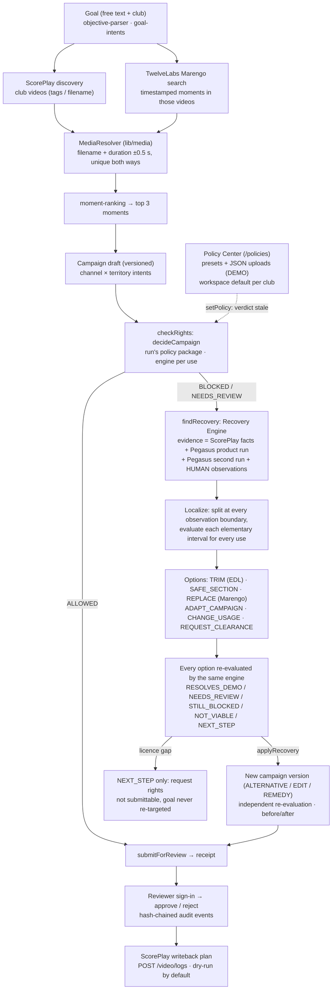

# PULSE × REROUTE — architecture

App: `reroute/` (Next.js 16, pnpm, zod v4, vitest). Contracts: `reroute/src/lib/contracts.ts`, PULSE view types: `reroute/src/features/pulse/types.ts`.
Promise: from business objective to rights-aware campaign — and automatically to a better alternative when something cannot be used.

## Flow

`canPublish(receipt)` is the only publication gate: it needs an approved review of an ALLOWED decision under a non-fictional policy. Every package (presets and uploads) is DEMO, so `publishable` is false today.

## Goal actions (`POST /api/pulse/goal`)

Every action after `run` carries `{ id, expectedVersion }` (stale → CONFLICT). All persist and append audit events.

| Action | Does |
|---|---|
| `run` | parse objective, discover + search, rank 3 moments, draft campaign |
| `select` / `draft` | pick a moment / rebuild the draft (optional https destination) |
| `checkRights` | evaluate the current campaign version for every intent under the run's package |
| `findRecovery` | Recovery Engine on the latest non-ALLOWED evaluation; stores the plan (`reroute_alternatives` + run `recoveries`) and a `RECOVERY_PLANNED` event; idempotent per evaluation |
| `applyRecovery {optionId}` | only an `applicable` option of the current plan; writes a new campaign version (REPLACE/SAFE_SECTION → ALTERNATIVE or EDIT, TRIM → EDIT with EDL, ADAPT_CAMPAIGN → REMEDY, CHANGE_USAGE → new usage) and re-evaluates from scratch; returns `beforeAfter` |
| `setPolicy {packageId}` | evaluate this run against another package of the same club; the current verdict becomes stale (`rights.current = false`) until the next `checkRights` |
| `submitForReview` | receipt for ALLOWED or NEEDS_REVIEW on the current version; refused for BLOCKED and for licence gaps |

Human review is `POST /api/receipts/[id]/review` (reviewer session). Desk equivalent of `findRecovery`: `POST /api/recover` (read-only, nothing persisted). The desk recovery panel offers **Apply cut** (TRIM/SAFE_SECTION as segments), **Use this clip** (REPLACE) and **Apply to intent** (ADAPT_CAMPAIGN/CHANGE_USAGE), then re-decides via `/api/decide` and records receipts via `/api/receipts`. Example verified in the UI (≈ 04:50 UTC, reported): solanke late goal 0:10–0:19 → "Remove 0:14.5–0:17.5" → both kept segments ALLOWED · DEMO.

## Recovery Engine (`lib/rights/recovery`)

Pure and deterministic; the server wrapper (`lib/server/recovery.ts`) only loads evidence and searches replacements.

- **Evidence:** ScorePlay facts (tags, squad, provenance), every TwelveLabs analysis run for the asset — the product's Pegasus run (live, then `reroute_observation_cache`) and the second independent Pegasus run recorded on 2026-10-23 (`lib/twelvelabs/recorded-runs.ts`, labelled "second run", CACHED) — plus HUMAN observations. Restrictions are localized on the union of runs.
- **Localization:** the selected range is split at every observation boundary; each elementary interval is evaluated for every use. A restriction in every interval is pervasive (no cut can remove it); otherwise it is localized.
- **Limits (`RecoveryLimits`):** ±0.5 s margin around AI boundaries; minimum post 3 s or 40 % of the moment; kept pieces < 1 s dropped.
- **Options:** TRIM (EDL, `edl.ts`), SAFE_SECTION (best contiguous clean section; relevance flagged when search did not match it), REPLACE (Marengo moments, each mapped to ScorePlay), ADAPT_CAMPAIGN (licensed subset of territories/channels), CHANGE_USAGE (`changesGoal: true`), REQUEST_CLEARANCE.
- **Re-evaluation:** every option is evaluated as its own edit by the same rights engine. `NOT_VIABLE` and `NEXT_STEP` are never applicable. **Licence gap** (the plan names no licensed market or channel at all): no trim, section, replacement, remedy or change of use is generated — only REQUEST_CLEARANCE "Request additional usage rights" — and the campaign is never submittable.
- **EDL:** source intervals kept/removed (with reasons, rule ids, observations) and their output timeline; `execution: PLAN_NOT_RENDERED` — "Edit plan — not rendered". The engine evaluates the kept source intervals, never a file.
- Presentation: `lib/server/recovery-view.ts` (shared by Studio and desk). Tests: `lib/rights/recovery/recovery.test.ts`.

## Module map (canonical files, under `reroute/src`)

| Area | Files |
|---|---|
| Contracts / errors | `lib/contracts.ts`, `lib/errors.ts`, `lib/api-client.ts` |
| Studio UI (`/`) | `features/pulse/studio/*`: PulseStudio (Goal → Media → Campaign → Compliance → Resolution → Review, `?run=&step=`), GoalComposer, MomentGallery, MomentPreview, CampaignStudio, RightsLens, **ComplianceEditor** (range track, "What PULSE tried first", suggested correction, other ways, Use revised plan), **PolicyPicker** (Change rules), Review (approval + receipt + writeback), Chrome, Diagnostics. Design system: `components/pulse/*`, `app/globals.css` |
| Policy Center (`/policies`) | `app/policies/page.tsx`, `features/policies/{PolicyCenter,PackageDetail,UploadPanel,api}.tsx/ts`; API `app/api/policies/{route,[id],select,sample}` |
| Rights desk (`/desk`) | `components/reroute/*` (shared `writeback-plan`, `reviewer`, recovery panel; competition + publishing club prefilled from ScorePlay facts); `app/api/{decide,recover}` |
| Goal service | `features/pulse/server/goal-service.ts` (run/select/draft/checkRights/findRecovery/applyRecovery/setRunPolicy/submitForReview), `app/api/pulse/goal/route.ts`, `features/pulse/{objective-parser,goal-intents,goal-campaign,campaign-builder,goal-view,moment-ranking}.ts` |
| Recovery | `lib/rights/recovery/{plan,edl,index}.ts`, `lib/server/{recovery,recovery-view}.ts` |
| Rights | `lib/rights/{engine,select,policy,registry,packages,blocker,club}.ts`, `lib/rights/policies/demo-{tottenham-pl,tottenham-commercial,spurs-fr-sponsored}.json`, sample upload `tottenham-international-window.sample.json`; `lib/server/{context,decide,access}.ts` |
| Discovery / search | `features/pulse/server/{scoreplay-discovery,goal-search,media-lookup,twelvelabs-moments}.ts` |
| Media identity / previews / replay | `lib/media/{link,resolver,preview,replay,index}.ts` |
| TwelveLabs | `lib/twelvelabs/{config,client,parse}.ts` (per-club index + key, Marengo, Pegasus), `lib/twelvelabs/{runs,recorded-runs}.ts` + `recorded/` (second run) |
| ScorePlay | `lib/scoreplay/{client,map,schemas,writeback,taxonomy}.ts` |
| Persistence | `lib/supabase-admin.ts`, `lib/server/store.ts`, `lib/server/repositories/*` (Supabase + in-memory adapter) |
| Auth / limits | `lib/server/{auth,rate-limit}.ts`, `app/api/auth/session`, `src/proxy.ts` |
| Simulated board | `features/pulse/server/service.ts`, `app/pulse/board` (behind `PULSE_BOARD_ENABLED`, SIMULATED) |

## Data stores (Supabase, all `reroute_*`, RLS on, no `anon`/`authenticated` grants)

| Table | Holds |
|---|---|
| `reroute_goal_runs` | goal run document (incl. recovery plans and applied options) + `version` (optimistic concurrency) |
| `reroute_campaigns`, `reroute_campaign_versions` | campaign and every immutable version (origin: PROPOSAL, SELECTED, DESTINATION, ALTERNATIVE, REMEDY, EDIT; EDL on EDIT) |
| `reroute_evaluations` | each rights check: media refs, intents, decision (ORIGINAL / ALTERNATIVE) |
| `reroute_alternatives` | blocker + every recovery option with its re-check per evaluation |
| `reroute_receipts`, `reroute_reviews` | submitted decision (all intents, campaign version, edit) and final human review |
| `reroute_events` | append-only, hash-chained audit trail (incl. `RECOVERY_PLANNED`) |
| `reroute_writeback_attempts` | planned/applied ScorePlay actions and mode |
| `reroute_observations`, `reroute_observation_cache` | HUMAN observations; cached Pegasus product-run output |
| `reroute_policy_packages`, `reroute_policy_selection` | uploaded JSON packages (forced DEMO, sha256 + uploader) and each club's workspace default — migration `20261023000000_reroute_policy_packages`, applied locally, **not** on the shared Supabase (needs approval; there uploads/default answer NOT_CONFIGURED, presets still work) |

Stored: ids, timestamps, decisions, evidence text. Never media files or preview URLs. Demo replay recordings (`reroute/demo-cache/`, re-recorded 2026-10-23T04:40:23Z for 8 Studio scenarios A–H incl. recovery searches) and the second Pegasus run (`lib/twelvelabs/recorded/`) live in the repo.

## Real vs simulated

| Real (live, read-only) | Simulated / fictional — always labelled |
|---|---|
| ScorePlay workspace: 728 media (123 videos, 605 photos); 58 Tottenham v Man Utd videos; 65 NBA videos | Every rule package (`demo-*`, uploads) → "DEMO POLICY — NOT VERIFIED LEGAL CLEARANCE" |
| TwelveLabs Marengo moments; Pegasus product run; second Pegasus run (recorded, CACHED) | Fan signals on `/pulse/board` (SIMULATED, off) |
| SP↔TL links (58/58 by filename + duration) | Writeback: dry-run plan only |
| Recovery re-checks, reviews, receipts, audit chain, timings | Edits: plans, not rendered · no sales/ROI figures |

Known gaps: Pegasus analysis is refused for videos over 60 min (the 6,335 s full match has no product-run observation); the 65 NBA videos are in no visible TwelveLabs index; ScorePlay assets carry no usage/licence metadata; edits are not rendered.

## Security model

- Secrets server-only (ScorePlay, TwelveLabs, Supabase secret key); nothing `NEXT_PUBLIC_` except an optional URL fallback.
- Reviewer actions (review, writeback, HUMAN observations, policy upload / workspace default, render, desk previews) need the reviewer session: HttpOnly HMAC-signed cookie, same-origin check on mutations, sign-in delay + per-IP lockout (per instance), named reviewers with personal passcodes (only hashes configured).
- Rules: unknown never becomes ALLOWED; AI observation is evidence, never a licence; a player's club is asserted only from ScorePlay identity; uploads are always DEMO; reviews are final.
- Request limits (≤ 20 segments, ≤ 21 intents, bounded request strings, query ≤ 500 chars), per-IP rate limits (`src/proxy.ts`, `lib/server/rate-limit.ts`; recovery 10/min on `/api/recover` and `findRecovery`; in-memory per instance), generic 500s, upstream bodies only in server logs; no footage URLs in API payloads while previews are off; uploader identity returned to signed-in reviewers only.
- External effects off by default: `SCOREPLAY_WRITEBACK_MODE=dry-run`, `MEDIA_PROCESSING_APPROVED=false`, `SCOREPLAY_UPLOAD_APPROVED=false`; a verdict tag is written only for an APPROVED review under a non-fictional policy.
