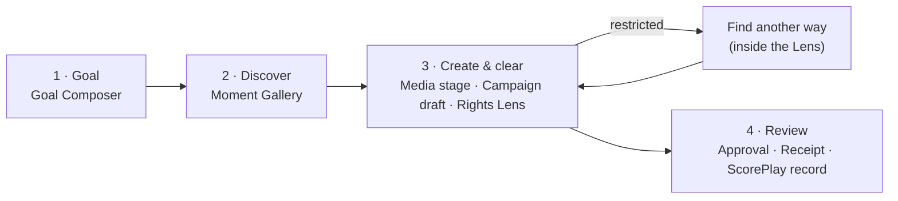

# PULSE — Design system (Sprint 01)

Direction: **sports editorial × professional software.** One product (PULSE); REROUTE is its rights engine and never
appears as a brand. Dark only. Source of truth: `reroute/src/app/globals.css` (tokens), `reroute/src/components/pulse/*`
(shell, motion), `reroute/src/features/pulse/studio/parts.tsx` (status, issues, progress, notices).

## Journey and information architecture

- One screen per step; the header step nav returns to any step already reached. URL: `/?run=<id>&step=<goal|discover|campaign|review>`;
  a reload restores the run and the step.
- The **objective bar** (goal, club, market, channels, use, data provenance) sits under the header on every step after Goal.
- `/desk` is the advanced **Rights desk** (frame-level evidence) with the same PULSE header; reached from the Lens
  ("Open frame-level evidence"). `/pulse/board` stays behind `PULSE_BOARD_ENABLED` (off). No separate REROUTE/CLEAR dashboard.
- CLEAR (`clear/`) is a separate, fully mock prototype (deterministic demo data, MUI); none of it is user-facing in PULSE.
  Its principles that already live in the engine (evidence ≠ licence, human checkpoint) are expressed in the Lens.

## Colour

| Token | Value | Use |
|---|---|---|
| `obsidian` | `#111514` | Page |
| `surface` | `#1C2321` | Panels, media frames |
| `surface-raised` | `#232B29` | Selected segment, frame gradient top |
| `ink` | `#F3F1E9` | Primary text |
| `ink-soft` | `#BCC2BB` | Body text inside panels |
| `ink-muted` | `#86928B` | Labels, metadata (5.6:1 on obsidian) |
| `line` / `line-strong` | ink at 8 % / 16 % | Hairlines, rings |
| `signal` | `#D4FB77` | Brand mark, the primary action, focus ring, current step. **Never a rights status.** |

Rights statuses have their own semantic colours and always come with an icon and a word:

| Status | Colour | Icon | Word |
|---|---|---|---|
| Not checked | `status-idle` `#86928B` | dashed circle | Not checked |
| Out of date | `status-idle` | history | Your campaign changed |
| Cleared (VERIFIED only) | `status-clear` `#7FD6A4` | circle check | Cleared |
| Allowed under demo policy | `status-provisional` `#DDD0A0` | dashed circle check | Allowed · demo policy |
| Needs review / not licensed | `status-review` `#F0B65E` | circle help | Needs review |
| Blocked | `status-blocked` `#F0907E` | circle slash | Blocked / Can't be used as planned |

Dashed = provisional: an ALLOWED under a fictional policy is never drawn like a verified clearance. Every fictional-policy
decision carries the dashed note **"Demo policy — not verified legal clearance"** (sentence case of
`DEMO_CLEARANCE_LABEL`; server strings that embed the label are rendered with the same wording).

Legacy bridge: `globals.css` re-points Tailwind's `zinc` and `sky` scales at PULSE neutrals and signal lime so the desk
and the flagged board stay on-brand without a rewrite. New code uses PULSE tokens only.

## Type

Two families, both SIL OFL 1.1, self-hosted by `next/font`: **Space Grotesk** (500/600; editorial: page titles, media
titles, timecodes, the hook) and **Geist** (interface; Geist Mono for ids and technical metadata).

| Token | Size / line | Face | Use |
|---|---|---|---|
| `text-display` | 40–64 px fluid / 1.0 | Space Grotesk | "What are we trying to achieve?" |
| `text-title` | 26–34 px fluid / 1.1 | Space Grotesk | Step titles, objective, media title |
| `text-headline` | 22 / 1.2 | Space Grotesk | Lens decision, section heads |
| `text-body` | 15 / 1.6 | Geist | Reading text, copy |
| `text-small` | 13 / 1.5 | Geist | Panel text, buttons |
| `text-meta` | 12 / 1.4 | Geist (Mono for ids) | Timestamps, sources |
| `text-eyebrow` | 11, +0.12 em, uppercase | Geist | One label per block, max |

`cn` (`lib/utils.ts`) is configured with these sizes so `text-meta` and `text-ink-muted` are never merged away as two colours.

## Components

| Component | File | Rules |
|---|---|---|
| Header + step nav | `components/pulse/shell.tsx`, `studio/Chrome.tsx` | Wordmark, 4 steps (future steps inert), reviewer, New goal. Steps drop to a second row on phones. |
| Goal Composer | `studio/GoalComposer.tsx` | One question, one field, one action (**Find opportunities**, Enter to submit). Live reading of goal · market · use from the same deterministic parser the server uses; unknowns in amber. Five intent chips; club as a segmented control. |
| Media frame | `studio/MomentPreview.tsx` | Without an authorized stream: the moment as a framed timecode, its position in the asset (segment track), "Preview off · awaiting playback rights". No thumbnail, no URL, no stock image. With `MEDIA_PREVIEW_ENABLED` + reviewer session: the existing timecoded player. Sizes: stage / lead / compact / thumb. |
| Moment Gallery | `studio/MomentGallery.tsx` | One lead moment (7/12) + two supporting (5/12). Title, timecode, club/match, why it fits, one action. Ranks and scores behind "Why this moment". |
| Campaign Studio | `studio/CampaignStudio.tsx` | Media stage (swaps in place on replacement) + campaign draft as a brief: hook, audience, KPI, uses, CTA, per-channel copy, destination link (the only editable field — the API edits nothing else). |
| Rights Lens | `studio/RightsLens.tsx` | Decision → scope ("0 of 3 uses · Instagram, Facebook, X in United Kingdom") → issue names → demo note → **one** primary action → "What we found" (per issue: **Observed** with its source, **Rule** with its policy tag; merged across channels × markets) → all uses (collapsed) → desk link. Sticky beside the media on desktop, directly under it on phones. |
| Find another way | `RightsLens.tsx` `Recovery` | Opens inside the Lens, "Same goal: …". CLIP → re-checked replacements, first usable one is primary, blocked ones say "Also restricted" (no button). CAMPAIGN → markets kept vs dropped + the remedy action. Licence gap → plain next step (request a licence), nothing executable. |
| Review | `studio/Review.tsx` | Receipt as a document (decision, policy + fictional/verified, uses, media, reviewer, dates; ids and hash chain collapsed). Approval panel. **Publishing locked** is a status line, never a disabled button. ScorePlay record (dry run) collapsed. |
| Progress | `parts.tsx` `StagedProgress` | Current stage + elapsed seconds + thin stage bar; labelled as an estimate. Replaces the decision while a re-check runs. |
| Notice | `parts.tsx` `Notice` | Conflict, missing run: hairline panel + icon, no tinted wash. |

## Layout and spacing

Container 1320 px, 20/32 px gutters. 12-column grid: 7 (media, brief, receipt) / 5 (Lens, approval). Sections are
separated by hairlines and space, not by boxes; panels (`surface` + `ring-line`, radius 12 px) only where something is
a distinct object (Lens, receipt, media). Spacing steps: 8 · 12 · 16 · 24 · 32 · 40 px.

## Motion (`components/pulse/motion.tsx`, `motion` 14)

| Transition | Treatment |
|---|---|
| Step change | `Swap`: fade + 6 px rise, 240 ms, ease-out-quint |
| Results arrive | `Reveal` with 80 ms stagger (gallery), 60 ms (alternatives) |
| Moment replaced | `Swap` keyed by moment: old frame fades out, new one in |
| Rights decision changes | `Swap` keyed by evaluation; progress replaces the decision during the check |

`MotionConfig reducedMotion="user"` drops transforms under `prefers-reduced-motion`; a CSS guard shortens all CSS
animations. No looping, floating or background animation.

## Open-source used

| Package | Version | Licence | Why |
|---|---|---|---|
| `motion` | 14.6.0 | MIT | Enter/swap transitions, reduced-motion handling. **Added this sprint.** |
| shadcn/ui (base-nova) + `@base-ui/react` | 4.22.1 / 1.9.0 | MIT | Button, Input, Tabs, Dialog — restyled through tokens |
| `cn` | 0.5.0 | MIT | Class merging (now configured with the type scale) |
| `lucide-react` | 1.61.0 | ISC | Icons |
| Geist, Space Grotesk (via `next/font/google`) | — | SIL OFL 1.1 | Type |

Evaluated, not adopted (no code copied): **Motion Primitives** (patterns re-implemented in 40 lines on `motion`),
**Origin UI** (segmented control and input patterns informed the composer and club switch), **Kibo UI** (no media/compare
component fits a disabled-preview world), **Media Chrome** (MIT; not needed while playback is unauthorized — revisit when
`MEDIA_PREVIEW_ENABLED` is approved).

## Before → after (Scenario A, desktop 1440 px)

| Screen | Before (`screenshots/before/`) | After (`screenshots/after/`) |
|---|---|---|
| Goal entry | `01-goal-entry` | `01-goal-entry`, `01b-goal-understood` |
| Moments | `02-moments` | `02-moments`, `02-moments-full` |
| Proposal / studio | `03-proposal` | `03-campaign-studio` |
| Rights, restricted | `04-rights-blocked`, `04b-rights-findings` | `04-rights-lens-blocked` |
| Find another way | `05-find-another-way` | `05-find-another-way` |
| Alternative adopted | `06-alternative-adopted` | `06-alternative-adopted` |
| Review | `07-review-pending` | `07-review-pending` |
| Receipt + writeback | `08-audit-receipt` | `08-audit-receipt`, `08-review-full` |
| Territory recovery | `09-territory-recovery`, `09a-territory-verdict` | `09-territory-recovery`, `09a-territory-verdict` |
| Licence gap (Mexico) | — | `09b-licence-gap` |
| Mobile 390 px | `10-mobile-top`, `10b-mobile-rights`, `10c-mobile-full` | `10-mobile-goal`, `10b-mobile-campaign`, `10c-mobile-campaign-full`, `10d-mobile-review-full` |
| Rights desk | `11-legacy-desk` | `11-desk` |
| Whole journey | `00-full-flow-desktop`, `00-full-flow-scenario-b` | one screen per step |

All files are `.webp`.

| Measure | Before (one page) | After · Discover | After · Create & clear | After · Review |
|---|---|---|---|---|
| Page height (px) | 3,332 | 1,377 | 1,656 | 979 |
| Visible words | 1,461 | 173 | 257 | 190 |
| Enabled buttons | 12 | 4 | 6 | 1 |
| Distinct text sizes | 10 | 9 | 8 | 5 |
| Text colours | 20 | 6 | 5 | 6 |
| Uppercase micro-labels | 36 | 5 | 3 | 3 |

Before, box/size/colour counts may include the collapsed diagnostics drawer (Chrome keeps closed `
` content
laid out); after counts exclude closed disclosures and screen-reader-only text. Sizes on Discover/Create are the scale
tokens plus the two fluid timecode sizes of the media frame.

## Key decisions

1. **Steps, not a scroll.** Four screens with one primary action each replace a 3,300 px document where every past step
   stayed expanded.
2. **Rights beside the work.** The Lens sits next to the media and the draft; "Find another way" opens inside it, so the
   campaign and the objective never leave the screen.
3. **Issues, not rows.** Findings are merged per problem (dimension + rule) and list the uses they affect; the 21-row
   per-use table is one collapsed line.
4. **Observed ≠ Rule.** Every issue shows the observation with its source and the rule with its policy tag in two
   labelled rows; the decision is the engine's, the AI output is evidence.
5. **Lime means "act", never "allowed".** Statuses have their own colours; provisional (demo) clearance is dashed.
6. **Unavailable is not a button.** Locked publishing, licence gaps and blocked replacements are status text.
7. **The moment is the media.** With previews off, the frame shows the exact timecode and its place in the clip rather
   than an empty player or a stand-in image.

## Known gaps (Sprint 02)

- The campaign draft is read-only except the destination link: editing copy, hook, channels or KPI needs API support.
- The rights desk keeps its six-panel layout; only its header, palette and labels are PULSE.
- The technical drawer (Diagnostics) still uses legacy micro sizes (10 px mono) inside the collapsed panel.
- No campaign history or receipt list: runs are reachable only by URL.
- Lead moment's action sits at the fold on a 1440 × 900 screen.

